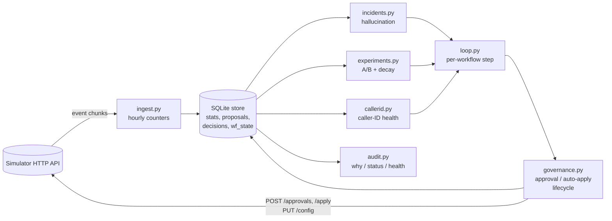

# Review notes (for the 60-minute live review)

Plain-language walk-through of the controller, then the five questions most likely to come up.

## The design in one page

The controller is one Python process (`python -m controller`, started by `./run.sh`). Each loop
step it does the same four things, then moves the simulator clock forward one hour:

1. **Ingest.** Download any new event chunks and turn every call into hourly counters in SQLite
   (dials, connected, engaged, hallucination-flagged), broken down by workflow, variant (welcome,
   voice, caller ID, prompt) and lead segment (`age_band=60+`, `lang=ta`, ...). A chunk and its
   "done" marker are written in one transaction, so nothing is counted twice or lost.
2. **Reconcile governance.** For every proposal still in flight, ask the simulator what happened
   (approved, rejected, expired). Apply approved ones straight away, inside the 2h apply window.
3. **Decide, per workflow, in priority order:**
   - *Hallucination incident.* Is the flag rate on the current prompt far above the workflow's own
     history? If so, roll back to the last prompt that ran cleanly, validate it, and propose with the
     validation id as evidence.
   - *Decay.* Has a promoted winner dropped significantly since its first day, to below the arm it
     replaced? If so, propose the rollback.
   - *Caller IDs.* Is any number picking up far less than the others over the same hours? Stop using
     it. Otherwise spread calls evenly over healthy numbers and test unused ones at 5%. Done by
     auto-apply where the policy allows `caller_id`, otherwise via approval.
   - *Daily batched proposal* (once a day after 11:00, inside approver hours): start, update or finish
     the A/B tests on welcome message and voice, plus caller-ID changes for workflows without auto-apply.
     All in one request.
4. **Record** the loop's own metrics (events, seconds, credits, memory).

Everything the controller knows lives in one SQLite file (`state/<scenario>.sqlite`). Kill it at any
point and `./run.sh` picks up from that file.



### The few rules worth memorising

| Thing | Rule | Why |
|---|---|---|
| Exploration split | champion 50%, challengers share 50% | fast enough to finish inside a week at ~1,000 connects/day; harm is bounded because bad arms get dropped |
| Drop an arm | worse than champion, one-sided z-test p < 0.05 / (k-1), ≥200 connects each | dropping is cheap and safe (traffic returns to the champion) |
| Promote a winner | better than champion p < 0.01 / (k-1), ≥300 connects each, ≥2% lift, no significant pickup drop beyond the guardrail | promoting is the risky direction, so it needs the stricter bar |
| Give up | 4 days with no winner → back to champion | no evidence, no change |
| Decay | winner's last 24h vs its first 24h after promotion, p < 0.01, and now below the old champion | the experiment-phase rate is inflated by the winner's curse (learned the hard way, see commits) |
| Hallucination | rate > max(2×baseline, baseline+1pp), ≥300 connects, p < 1e-4 if the prompt changed in the last 24h, otherwise 12h window and p < 1e-6 | prompts don't change behaviour by themselves; an unchanged prompt needs more evidence |
| Caller ID | pickup < 0.7× the other numbers over the same hours, ≥300 dials, p < 1e-4 | randomised per dial, so the leads and hours are the same; only the number differs |
| Customer-facing changes | always through `/approvals`, even where Kestrel's policy would allow auto-apply | Northwind compliance and the Kestrel supervisor both asked; it costs us a few hours |
| Supervisor edits | the dims they touched are hands-off for 24h; incidents are the only exception, and say so in the request | "don't undo my changes behind my back" |

## The five questions I expect, and my answers

**1. "Walk me through why workflow X changed at time T, from your store."**
Run:
```bash
python -m controller.audit --db state/public_02/public_02_incidents.sqlite why ks_cancel --at "D3 20:00"
```
It finds the config version live at T, who made it (supervisor, auto-apply under policy, or approval
id), the proposal behind it (summary, diff, dry run, impact score, evidence, the test statistics in
the rationale), the decision trail (sent, approved, applied), the 24h KPIs before and after, and the
next change. `timeline <wf>` shows every detection and decision in order. Every decision row is
written by the code that made the decision, with the numbers it used.

**2. "How do you know your winner isn't a false positive? What's your false-winner rate?"**
Two-proportion z-test against the champion, Bonferroni across challengers (alpha 0.01/(k-1)),
minimum 300 connected calls per arm, minimum 2% lift. We look once a day, so a test that runs four
days peeks up to four times; that inflates the per-look alpha to roughly 2-4% family-wise per
dimension. On public_01 one voice "winner" (V2 on nw_renewal) had no true effect: it was graded
neutral, not harmful, which is the usual cost of a false winner when the true difference is ~0.
What protects us is that a false winner is a near-zero change, and the decay check rolls back a winner
that later drops below the old champion. To go further I'd use a sequential test (e.g. an
alpha-spending boundary) instead of fixed-alpha peeking.

**3. "What happens if I kill it right now?"**
Ingestion: the chunk transaction rolls back and is re-ingested on restart. Proposals: the row is
written as `sending` before the POST and `applying` before the apply call. On restart, `reconcile`
asks the simulator: is there an approval with this proposal_id? Has this approval been applied (config
history has its approval_id)? Proposal ids are unique, so a retried POST gets `409 duplicate` instead
of creating a second request. Learning state (experiments, caller-ID health, incidents) is saved
before any external side effect. `scripts/crash_test.py` SIGKILLs it three times on public_02
and checks that calls were counted exactly once, nothing was applied twice and no approval was lost
(`reports/crash_recovery.md`). What can repeat: an audit `decisions` row for a detection made just
before the kill (at-least-once for log lines, exactly-once for changes).

**4. "Change a constraint: what breaks?"** Likely ones:
- *Approver quota drops to 1/day:* safety proposals keep priority (regular proposals leave one slot
  free), but A/B tests slow to one change a day and a rejection costs a day.
- *Auto-apply removed for caller IDs:* caller-ID moves fall back to the daily batched approval and an
  urgent "stop using D2" becomes its own safety request; nothing else changes.
- *`max_shift` lowered:* auto-applied caller-ID moves take more one-hour steps; draining a flagged
  number gets slower.
- *Tick or apply window shorter than our 60-minute step:* we'd miss apply windows. The step size is a
  flag (`--step-minutes`), but it's not adaptive.
- *More workflows (10×):* the per-workflow step is ~3 HTTP calls and a few SQL aggregates. Ingestion is
  the hot path (see SUBMISSION §8).

**5. "Why did you cut X?"** (per-person call time, per-cohort targeting, supervisor UI, fairness)
I chose to finish the safety-critical loop properly (governance, incidents, caller IDs, decay,
crash safety, audit) rather than sketch the lift features. Per-cohort winners are the biggest lift
left on the table: the hidden effects are mostly segment-specific (V3 for 60+, V2 for Tamil
speakers). The counters are already broken down by segment, so the next step is a per-segment test
that creates a cohort when a segment's winner differs from the population winner, with a cap on how
many cohorts we create. Per-person call time needs a pickup model per person from very few dials each;
per-cohort hour weights should come first. The supervisor view is a CLI (`audit status`), not a UI.

## Where to look in the code

| File | What it owns |
|---|---|
| `controller/loop.py` | the main loop and the per-workflow decision order; proposal packaging (diff, dry run, affected leads, impact) |
| `controller/governance.py` | proposal lifecycle state machine, reconcile after crash, quota counting |
| `controller/experiments.py` | A/B state machine, z-tests, promotion, elimination, decay |
| `controller/callerid.py` | caller-ID health states and target allocation |
| `controller/incidents.py` | hallucination detection, fix choice, validation, post-fix checks |
| `controller/ingest.py` | chunk → counters, idempotent |
| `controller/store.py` | SQLite schema |
| `controller/audit.py` | `why`, `timeline`, `status`, `health` |
