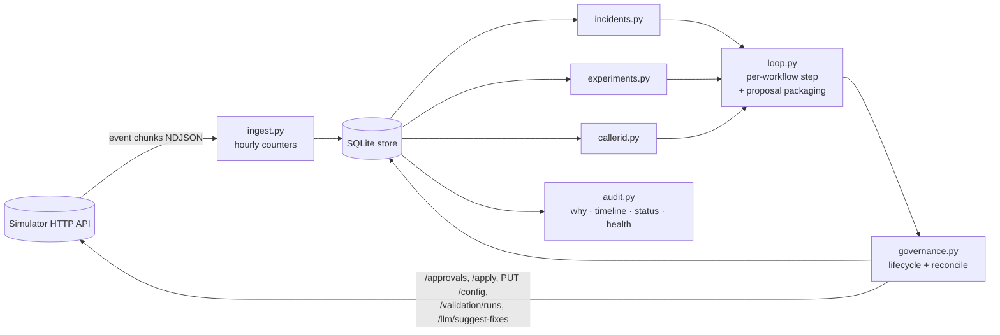

# Outcome-First Agent Loop — Submission

**Name:** Aditya Kantipudi · **Date:** 2026-11-09 · **Hours actually spent (be honest):** ~7 h in one day,
built with an AI coding assistant (allowed by §10); every design choice below is mine to defend ·
**Language / storage:** Python 3.10, stdlib + `httpx` (already in requirements.txt) / one SQLite file

---

## 0. TL;DR

- One Python process. Each simulated hour it ingests events into hourly counters in SQLite, reconciles
  every proposal with the simulator, then per workflow handles, in order: hallucination incidents,
  winner decay, caller-ID health, and one batched daily proposal for welcome × voice A/B tests.
- Winners are picked by a two-proportion z-test (Bonferroni, minimum samples, minimum lift). An LLM is
  only used to suggest prompts when there is no known-good prompt to roll back to.
- **public_01:** conclusion rate +11.3% vs baseline; the decaying W3 winner was rolled back.
  **public_02:** +25.3%; the supervisor's hallucinating P2 was caught by validation 30 min after it
  shipped and rolled back (MTTR 210 min, mostly approver latency); the spam-flagged D2 was drained
  by auto-apply. Credits used: 10 of 200.
- Crash safety is demonstrated with injected crashes at the four dangerous points plus three SIGKILLs.
  One full-scale day of public_03 takes 33 s of wall-clock.
- **Cut:** per-segment cohorts, call-time optimisation (C4), history-based priors (C3 beyond baselines),
  a supervisor UI (a CLI instead), and cross-tenant fairness (C15).

## 1. Assumptions

1. `pickup_rate_max_drop: 0.02` is an absolute drop of 2 percentage points (not 2% relative).
2. For pickup-primary workflows (KYC), welcome and voice are heard only after pickup, so they cannot
   move the primary KPI. We still test them to improve engagement (the guardrail) and the business outcome,
   and only promote if pickup doesn't drop.
3. `max_shift` caps a single auto-applied change. Moving further in hourly steps, re-measuring in between,
   is within policy. We use this only for caller IDs.
4. Auto-apply is permitted for welcome/voice on Kestrel, but we route every customer-facing change
   (welcome, voice, prompt) through `/approvals` anyway. Northwind compliance requires it, and the Kestrel
   supervisor asked to know before anything customers hear changes.
5. Spreading calls across healthy caller IDs is good practice (carriers label high-volume numbers as spam).
   This is general industry knowledge, not something read from the scenario's hidden truth.
6. The workflow's own hallucination-flag rate in the history before D0 is its "normal". The detector
   has false positives, so normal is not zero (~1.5% on public scenarios).
7. A prompt that ran on real traffic with a normal flag rate is the safest fix for a bad prompt. It still
   gets a validation run, because approvers require one.
8. A rejected, expired, lapsed or stale proposal is never resent. The planner re-plans from fresh data
   and sends a new proposal (Product's rule).
9. The simulator's clock waits for us. Production wouldn't (see §8 for what that changes).
10. Approver identity is not exposed by the API. "Who approved" is recorded as the approval id and the
    workflow's approver, and auto-applies as "policy".

## 2. Scope decisions

| # | Capability | Built / Partial / Cut | Why | What it would take to finish |
|---|---|---|---|---|
| C1 | Event ingestion at load scale | **Built** | everything depends on it; idempotent per chunk | streaming parse + sharding for 10× (§8) |
| C2 | Shared cohort object | Partial | counters are kept per feature segment (`age_band=60+` ...), the one definition used everywhere; no config cohorts are created yet | per-segment tests that create a cohort when a segment's winner differs |
| C3 | Bootstrapping from history | Partial | history sets each workflow's flag-rate baseline, caller-ID usage and the prior prompt's track record | per-segment hour-of-day pickup curves from history (input to C4) |
| C4 | Call-time optimisation | **Cut** | real pickup lever, but it doesn't touch safety; per-person needs a model per person from 2–8 dials each | per-cohort `hour_weights` from history first, then per-person for returning leads |
| C5 | Caller-ID health | **Built** | public_02 incident; also the biggest pickup win (spreading load) | rest/re-probe policy tuned on more data |
| C6 | Welcome × voice experiments | **Built** (workflow level) | core of "earn autonomy" | per-segment analysis (C2), sequential testing |
| C7 | Promotion, decay, rollback | **Built** | the decay trap is in both public scenarios | holdout arm for decay instead of before/after |
| C8 | Hallucination incident flow | **Built** | regulated clients; public_02 incident | engagement guardrail per prompt with more data |
| C9 | Governance client | **Built** | non-negotiable constraint | approver-hour-aware timing for safety requests |
| C10 | Impact scores, affected leads, dry runs | Partial | computed from observed arm rates, honest about missing data | replay against historical cohorts per segment |
| C11 | Supervisor view | Partial | CLI `audit status`: what's tested, winning, waiting on you, changed today | an HTTP endpoint / page on top of the same queries |
| C12 | Audit store | **Built** | floor requirement | — |
| C13 | Crash recovery demonstrated | **Built** | SRE non-negotiable | — |
| C14 | Loop observability | Partial | `loop_metrics` table + `audit health` (events, lag, actions, credits, RSS) | alert rules wired to a pager |
| C15 | Fair credits/attention across tenants | **Cut** | not exercised by public scenarios; credits barely used | per-tenant budget table, quota-aware queue |

**Principle:** first, anything whose absence makes the system unsafe for a regulated client: governance,
incidents, caller IDs, decay, crash safety, audit. Then the main learning loop (C6) done properly at
workflow level, rather than the lift features (C2/C4) done halfway. The CTO's line decided it: "an
improvement that hurts a cohort is worth less than nothing".

## 3. Stakeholders

### 01 — Nikhil Rao, VP Sales

- **Accepted:** speed where it's safe. Caller-ID fixes auto-apply within the hour where policy allows. One
  batched request per workflow per day, so we don't look hesitant. Per-workflow lift numbers for the summit,
  straight from `sim grade`-style reports.
- **Declined:** a single blended score (README §1 and Product forbid blending pickup and engagement).
  "Winning by lunch, live by evening" (a lunchtime lead on a few hundred calls is usually noise; we
  need ≥300 connected calls per arm and p < 0.01). Rolling out the "persuasive" prompt everywhere.
- **Wrong claims:**
  - "Kestrel has turned on auto-apply for everything": `ks_cancel` allows only schedule, caller ID,
    welcome and voice, at ≤0.2 total-variation shift per change. Prompt and cohort changes need approval.
  - "Northwind is fine with auto-apply on KYC": `nw_kyc` has `auto_apply.enabled: false` and no allowed
    dims, and Northwind's compliance head requires named approval for anything customers hear.
  - The "persuasive" prompt is P4, with a hallucination rate high enough that it sits right at the 0.97
    validation bar (it validated at 0.974 once). It's not offered on KYC at all, and a win in another
    account doesn't transfer (Product: winners stay in their workflow).
- **Reply:** "Nikhil — you'll have per-client lift numbers for the summit, reported separately for pickup and
  engagement (we can't blend them; it's a product rule and our clients' compliance teams check). Two
  corrections before the deck: Kestrel's auto-apply covers caller ID, schedule and small voice/opening-line
  shifts only, and Northwind KYC has auto-apply switched off. Every change there needs a named approver.
  The persuasive prompt hallucinates enough to fail our validation bar, so it's off the table for regulated
  clients. What we can show: the agent found a better opening line, rolled it back on its own when it
  stopped working, and fixed a bad script within hours. Each step has a reason a compliance head can read."

### 02 — Meera Iyer, Head of Compliance, Northwind Life

- **Accepted, and where it lives:**
  1. Every customer-facing change (welcome, voice, prompt) goes to `/approvals` with summary, diff,
     dry run, affected leads, impact score and rationale. That's true even on workflows where policy
     would allow auto-apply.
  2. Script changes always carry `evidence.validation_run_id`, and the approver checks it is ≥0.97 for that
     workflow and prompt.
  3. "Why did this customer hear X": every call event records `config_version` and `variant`. Our store maps
     each version to its proposal, approval id and statistical evidence (`audit why <wf> --at "D3 14:00"`,
     §10). The answer is per variant and reason, at version granularity.
  4. Regular proposals go out only inside approver hours: from an hour after opening to three hours
     before closing (11:00–16:00 renewal, 11:00–15:00 KYC).
- **Pushed back:** "slow and right" vs any exploration. A test means some customers hear an untested
  opening line. We bound that (bad arms are dropped as soon as they're significantly worse) but can't make
  it zero. Safety requests (an incident) are sent immediately, even at night, because the alternative is
  leaving a hallucinating script live until morning.
- **Wrong claim:** the "operational latitude on caller-ID rotation and call timing" holds for renewal
  only. On KYC the signed policy has auto-apply disabled, so caller-ID changes there also go to your
  approvers, batched into the daily request. Also, we keep per-call variant data at version level, not a
  per-lead transcript store, so the 24h answer is "lead L was dialled under version V, which allocated
  voices as follows, for this reason".
- **Reply:** "Meera — agreed on all five conditions; they match how the system is built. Opening line,
  voice and script changes always go to your named approvers with a diff, a dry run against your own call
  data and the statistical evidence; script changes also carry a validation run that meets your 0.97 bar.
  One correction: the latitude for caller-ID rotation applies to renewal only. Your KYC policy has
  auto-apply off, so those changes come to your approvers too. Regular requests arrive after 11:00 in your
  approver hours, at most one per workflow per day. The exception is a hallucination incident, which we
  send immediately. Auto-applied caller-ID changes are listed in the weekly summary with their reason."

### 03 — Kabir Menon, Platform & SRE

- **Accepted:** the kill/restart test, demonstrated (§9, `reports/crash_recovery.md`). Idempotency by
  proposal id and per-chunk ingestion. The 10-minute budget (one full-scale day: 33 s). The loop's own
  health without reading logs (`audit health`, `loop_metrics`).
- **Pushed back / declined:** "no new stateful infrastructure". SQLite is a file, not a server, so there is
  nothing to operate at 2 a.m. In production I'd put the same tables in your existing Postgres instead.
  Alerting is designed (§10) but not wired to a pager.
- **Wrong claims:** none against the contract. One caveat: "the clock doesn't wait" isn't true in the
  simulator. We measured headroom (~30×), but nothing here exercises falling behind.
- **Reply:** "Kabir — kill/restart: `scripts/crash_test.py` crashes the controller right after the simulator
  accepts an approval request, an apply and an auto-apply (before we record them), and mid-ingest, then
  SIGKILLs it three more times. Calls are counted exactly once, nothing is applied twice and no approval
  is lost (report attached). One full-scale day of public_03 takes ~20 s of controller time at
  ~80k events/s; memory breaks first at 10×. State is one SQLite file, no new service; in prod it'd be
  tables in our Postgres. Paging rules are in the doc; only incident and stuck-proposal alerts page."

### 04 — Anita Desai, Operations Supervisor, Kestrel Finance

- **Accepted:** her edits are never silently undone. Any dim she touches is hands-off for 24h. No regular
  request before 11:00, and at most one batched request a day (her limit is two). One screen:
  `python -m controller.audit status` shows what's tested, what's winning, what's waiting for her and what
  changed today. "Don't ship a compliance-script bot": a prompt fix is followed by an engagement check,
  and a fix that cuts engagement >5% is replaced.
- **Pushed back:** if her own prompt edit hallucinates, we will propose reverting it. Never silently:
  it's an approval request that names her edit and carries the evidence. On public_02 exactly this
  happened: her P2 failed validation (0.938 < 0.97) 30 minutes after she shipped it. Also, caller-ID
  rotation auto-applies on her workflow (her policy allows it). It's operational, not something customers
  hear, and it's listed in her status screen.
- **Wrong claims:** "two requests a day max". Her signed policy allows four per 24h. We stay under two for
  routine work but keep the remaining slots for incidents. And "tell me before anything changes on a running
  campaign": her policy is `mid_flight: allowed` with auto-apply for voice and opening line, so the contract
  doesn't require telling her. We choose to route those through her approval anyway.
- **Reply:** "Anita — we won't touch anything you change for 24 hours, and we won't undo it quietly. If one
  of your prompts starts hallucinating, you'll get a request saying exactly that, with the validation result.
  You'll get at most one routine request a day, after 11:00, with everything batched. Urgent safety
  fixes are the only exception. Caller-ID rotation does happen automatically (your policy allows it), and
  it shows on your one screen with the reason. We don't judge a script by safety alone: if a fix makes
  people hang up, we treat that as a regression too."

### 05 — Tara Kulkarni, Head of Product

- **Accepted:** separate KPIs everywhere (counters keep dials, connected and engaged separately; promotion
  checks the guardrail). Proposals always carry impact, diff, affected leads and dry run, with defined
  meanings (§6). Expired = rejected → re-plan with fresh data and a new proposal id, never a resend.
  "Only what actually happened counts": every statistic comes from the call event's recorded variant, so
  an arm that never ran has zero samples and can't win. Winners stay in their workflow.
- **Min cohort size and window — my answer:** ≥300 connected calls per arm to promote (≥200 to drop),
  window = since the test allocation went live, 4-day limit. The cost: with ~1,000 connects/day and 3–4
  arms, a ~10% lift takes 2–3 days to confirm. A 5% lift often doesn't confirm inside 4 days (public_01
  ks_cancel V4). Lowering the bar to 150 calls roughly halves the time and doubles the false-winner rate.
- **Declined (for now):** per-person call time (not the P0 I'd pick: it needs a per-person pickup model
  from 2–8 dials per person. Per-cohort hour weights come first). Supervisor view: a CLI, not a UI.
  Caller-ID health: built.
- **Wrong claims:** none on definitions. "Rank the queue by impact score": the simulated approver doesn't
  rank, so we couldn't test it. Impact is still meaningful (§6).
- **Reply:** "Tara — pickup and engagement are never blended; shared cohorts are defined once as feature
  segments and used by detection, tests and the status view. My call on cohort size: 300 connected calls per
  arm to promote, 200 to drop, 4-day cap. It confirms ~10% lifts in 2–3 days and misses most 5% lifts; I'd
  rather miss a small win than ship a false one. Of your three P0s I built caller-ID health properly and a
  CLI supervisor view; per-person call time is cut. It needs a model per person and per-cohort timing is
  the right first step. Expired proposals are re-planned on fresh data, never resent."

### 06 — Aryamann, CTO

- **Accepted:** explainability over lift (every change has a test statistic and a reason in the store).
  "No compute": public_02 used 10 of 200 credits: two 500-sample validations, zero LLM calls, because
  rolling back to a known-good prompt beats asking for a new one. Scale numbers and what breaks first
  (§8). A written list of who I said no to (this section).
- **Pushed back:** none. The memo asks for judgement, not a feature.
- **Wrong claims found in the other memos:** Sales on Kestrel and Northwind auto-apply; Compliance on
  KYC caller-ID latitude; Ops on her request limit and what the policy requires her to be told (above).
- **Reply:** "Aryamann — I built the safety loop properly and the lift features at workflow level only:
  governance, incidents, caller-ID health, decay rollback, crash safety and audit. I cut per-segment
  cohorts and call-time optimisation, which is where most of the remaining lift is, and said no to Sales on
  blended scores, auto-apply and the persuasive prompt. Per-segment tests are next."

## 4. Architecture



Each step: **ingest → reconcile → per workflow (incident → decay → caller IDs → daily batch) →
metrics → advance 60 min.**

**State and where it lives (all in `state/<scenario>.sqlite`):**

| Table | Holds | Written |
|---|---|---|
| `chunks_done`, `stats` | which chunks are counted; hourly counters per workflow × dim × arm × segment | one transaction per chunk |
| `leads`, `campaigns`, `config_changes` | lead features (last 5 days), campaign sizes, every config version and who made it | with the chunk |
| `proposals` | every request, full body, lifecycle status, approval id, applied version | intent **before** each HTTP call, result after |
| `decisions` | append-only audit log: detections, test results, proposals, outcomes | at decision time |
| `wf_state` | per-workflow learning state (A/B phases, caller-ID states, incident) as JSON | before any side effect, and end of step |
| `validations`, `loop_metrics` | paid validation runs (reused), the loop's own health | as they happen |

**On restart:** open the same file (a new simulator world is detected and the old file moved aside),
skip ingested chunks, reconcile every `sending`/`pending`/`approved`/`applying` proposal against the
simulator by proposal id / approval id, reload state, continue at the simulator's current minute.

## 5. The learning loop

- **Cohorts.** Every counter is also kept per single-feature segment (`lang=ta`, `age_band=60+`,
  `city_tier=1`, `value_band=high`). That's the one cohort definition, matching the config's `where`
  syntax. The tests currently decide at workflow level, so we don't fragment traffic: segment counters
  exist for analysis and the next step (per-segment winners), but no config cohorts are created yet.
  Minimum sizes: 300 connected calls per arm to promote, 200 to drop.
- **Experiment design.** Welcome and voice are tested together. The simulator samples them independently per
  call, so this is a factorial design and each dimension's main effect uses all the traffic. Champion
  (current majority arm) keeps 50%, challengers share 50%. Interactions are ignored (assumed
  multiplicative); with 3×4 arms a full interaction test would need ~12× the sample. Exploration is
  explore-then-commit, not a bandit. Every allocation change needs an approval, and approvers allow 2–4
  per day, so a bandit's frequent small updates aren't available.
- **Deciding a winner.** Two-proportion z-test of engagement (engaged ÷ connected) of each challenger vs the
  champion, over calls since the test allocation went live (all arms concurrent, so hour, prompt and lead-mix
  shifts hit every arm equally). Promote if p < 0.01/(k−1) (Bonferroni), ≥300 connects each, lift ≥2%, and
  pickup not significantly below the champion by more than the guardrail. Drop an arm if worse with
  p < 0.05/(k−1). Stop after 4 days with no winner and return to the champion. Peeking: one look per day,
  ≤4 looks, so the family-wise false-winner rate is a few percent per dimension. In one development
  run, 1 of 5 promotions (nw_renewal V2) had no true effect; it was graded neutral.
- **Decay and rollback.** A promoted winner's last 24h is compared with its first 24h after promotion,
  under the same prompt. Roll back if the drop is significant (p < 0.01) and the winner is now below the
  old champion's rate. My first version compared against the experiment-phase rate. That rate is inflated
  by the winner's curse, so it rolled back a genuine small win on public_01 (see commit a665aae). On
  public_01, W3's share went from 100% to 17% on day 6 after decay onset and 0% on day 7. On public_02, 0%
  on day 5.
- **Call time and caller ID.** Call time: cut (§2). Caller ID: each number is healthy, probing (5% share
  until 300 dials) or unhealthy. Flag a number when its pickup is below 0.7× the other numbers' over the same
  hours (6h and 24h windows, plus since-probe-start for probes), with ≥300 dials and p < 1e-4. Target: equal
  split over healthy numbers. A flagged number rests 48h (doubling on each repeat flag), or 7 days if its
  pickup was under half the others' (spam-labelled). History tells us which numbers were already in use.
- **Guardrail.** Promotion is blocked if the winner's pickup is lower than the champion's by more than
  `pickup_rate_max_drop` with p < 0.05. For prompts, a fix is checked against pre-incident engagement and
  replaced if engagement falls >5% (p < 0.01). Welcome and voice can't move pickup in this world, so the
  pickup guardrail never fired. It exists for a world where they can.

## 6. Governance

```
                 ┌──────────── not_sent (refused / crashed before the simulator saw it)
  sending ──► pending ──► approved ──► applying ──► applied
                 │            │            ├──► lapsed  (410, outside apply_by) ─┐
                 ├► rejected  │            └──► stale   (409, base changed)     ├─► planner re-plans from
                 └► expired   └► superseded (a safety fix is pending; let it lapse)┘   fresh data, new id
```

- **Batching and timing.** At most one regular ("experiment") request per workflow per day, batching every
  welcome/voice/caller-ID change. Sent no earlier than an hour after approvers start and no later than
  three hours before they stop, so decide + apply fit. One retry the same day if rejected. Regular requests
  leave one slot of `max_requests_per_24h` free for safety requests (incident, decay rollback, flagged caller
  ID), which go out at any hour. Approved changes are applied at the next step (≤60 min, inside the 2h
  window). Peak requests per 24h on public_02: 2 / 1 / 1 (nw_renewal / nw_kyc / ks_cancel) (limits 3/2/4).
- **Auto-apply.** Used only for caller IDs, and only where the policy allows them, in steps of ≤0.98×
  `max_shift`, at most one per hour. Never while an approval for that workflow is pending (it would make the
  approval stale), unless a flagged number is still in use. We never auto-apply welcome or voice, even
  where allowed (§1.4).
- **Impact score.** For tests: min(1, |expected relative change in the primary KPI from the dry run| × 5),
  floor 0.1. So 20% expected change = 1.0, and a test start (no data yet) = 0.1. Decay rollback ≥0.6,
  flagged caller ID 0.8, hallucination incident 1.0. Ranking by it puts safety first, then big confirmed
  wins.
- **Affected leads.** Leads in campaigns still inside their cadence × the share of traffic whose treatment
  changes (total-variation distance), or for `next_campaign_only` workflows the next batch.
- **Dry run.** Re-weights each arm's observed rate over the last 7 days of this workflow's own calls by the
  proposed allocation. Arms with <100 connected calls are listed as "no data" and assumed equal to the
  current mix, so a test start honestly shows ~0 expected change. For prompts, observed flag and engagement
  rates per prompt are shown.
- **Supervisor edits mid-experiment.** Detected from `config_changed` events (`actor: supervisor`). The
  simulator re-normalises weights on every write, so its `changed_dims` can list allocations that didn't
  really move; we compare with the config seen last step. Touched dims go on a 24h hold. Afterwards the test
  restarts with the supervisor's choice as champion. Our pending request becomes stale and is re-planned,
  never forced. On public_02 the nw_renewal voice edit (D5 15:00) did exactly this.

## 7. Incidents

**Detection.** Flag rate on the current prompt vs the workflow's own pre-D0 rate (~1.5%). Fire when the
rate is > max(2× baseline, baseline + 1pp) over ≥300 connected calls, using a one-sided binomial test:
- p < 1e-4 over 6h if the prompt changed in the last 24h;
- p < 1e-6 over 12h if it has run unchanged for longer.

An earlier version used one rule for both and raised a false alarm on public_02 (17 flags in 387 calls
on a healthy, unchanged P1; checked against the raw events). It then "fixed" it with P5, the strict
script, at −14% engagement. With ~700 tests per run the stricter rule for unchanged prompts brings the
expected false alarms per run to ~0.001. A new supervisor prompt is also validated immediately (5 credits).

**Fix selection.** (1) Roll back to the most recent prompt that ran on this workflow's real traffic with a
normal flag rate. Validate it (500 samples, 5 credits) because approvers require it, and reuse that
validation for re-proposals. (2) Only if none exists: `suggest-fixes` (3 credits), validate each candidate,
take the highest pass rate (ties keep the LLM's order). (3) After apply: close the incident when ≥300
connected calls on the new prompt show a normal rate. Reopen if engagement falls >5% vs before the incident.
Credit reserve: 10 credits are kept back for validations.

**public_02 timeline (ks_cancel, from `audit timeline ks_cancel`):**

| Sim time | What happened |
|---|---|
| D2 10:00 | (hidden) caller ID D2 spam-flagged |
| D2 12:00 | D2 pickup 0.118 vs 0.298 on other numbers (6h, p < 1e-4) → unhealthy, 7-day rest |
| D2 12:00, 13:00 | auto-apply D2 33% → 14% → 0% (two steps, `max_shift` 0.2) |
| D3 11:30 | supervisor ships P2 |
| D3 12:00 | validation of P2: 0.938 < 0.97 → incident opened; P1 (known-good) validated 0.990 → rollback requested |
| D3 15:00 | approved and applied (approver latency was the 3h) → MTTR 210 min |
| D3 19:00 | flag rate on P1 back to 0.017 (baseline 0.015) → incident closed |

Hallucinated calls on ks_cancel: 98 vs 348 in the baseline.

## 8. Scale

Measured on public_03 at full scale for one simulated day (`reports/public_03_load.md`; one day because the
laptop had 1.9 GB of free disk and a full run writes ~4 GB of events):

| | |
|---|---|
| events ingested | 1.34 M (1 history day + D0; 604,516 dials on D0) |
| ingest throughput | ~80k events/s, single process |
| decision lag per hourly step | median 0.77 s, worst 1.4 s (first step 6.7 s: history backlog) |
| wall-clock per simulated day | ~20 s controller time; 33 s including the simulator |
| peak memory | 816 MB RSS |

**At 10×**, memory breaks first (whole-chunk buffering and the lead-features map, ~2–3 GB). Then
single-core ingest (~110 s/day, fine) and ~3 HTTP calls per workflow per step. **Partitioning:** shard by
workflow id across workers. Nothing in a workflow's loop reads another workflow's data. Tenant-level
budgets (credits, approver attention) go in one small shared table. In production, use the existing
Postgres rather than SQLite files.

## 9. Reliability

**Test:** `python scripts/crash_test.py` (public_02), result in `reports/crash_recovery.md`. It injects
crashes (`os._exit`, no cleanup) at the four dangerous points:
- mid-ingest transaction;
- right after the simulator accepted an approval request;
- right after an apply;
- right after an auto-apply.

It then SIGKILLs at three more times and restarts with the same state each time. All invariants hold:

- the scenario finished;
- calls counted exactly once (104,000 = 104,000);
- no approval applied twice;
- all 17 approvals in our store;
- nothing left half-sent;
- no duplicate-id errors;
- 3 recovery paths exercised.

**What is lost:** nothing that affects decisions. A detection logged just before a kill can be logged
again (audit rows are at-least-once; changes are exactly-once).

**Idempotency keys:**
- chunk number (ingest);
- `proposal_id` = `<wf>:<kind>:m<minute>:<n>` (requests and auto-applies; the simulator rejects reuse);
- approval id (apply);
- reconcile by looking both up on the simulator.

**4xx/5xx:** transport errors and 5xx are retried with backoff (6 tries). 4xx goes back to the caller:
- 409 stale → re-plan;
- 410 lapsed → re-plan;
- 402 credits → log, no retry;
- 403 auto-apply refused → recorded with the reasons.

## 10. Audit & observability

```text
$ python -m controller.audit --db state/public_02/public_02_incidents.sqlite why ks_cancel --at "D3 20:00"
== ks_cancel at D3 20:00: config v9, applied D3 15:00 by controller_approved, changed ['voice', 'prompt_version']
   proposal ks_cancel:incident:m5040:7 (incident) created D3 12:00 via approval
   approved by the client approver on apr_00005; status now applied
   summary  : ks_cancel: switch prompt P2 -> P1 because P2 failed validation; P1 validated at 0.990
   diff     : {"prompt_version": {"from": "P2", "to": "P1"}}
   dry run  : {"prompt_version": {"P1": {"connected": 8207, "flag_rate": 0.0146, "engagement": 0.5025}, "P2": {"connected": 59, "flag_rate": 0.0508, "engagement": 0.4068}}}
   impact   : 1.0  affected leads: 4500
   evidence : {"validation_run_id": "val_00002"}
   decision trail:
     D3 12:00 proposal_sent: ks_cancel: switch prompt P2 -> P1 because P2 failed validation; P1 validated at 0.990
     D3 15:00 approval_approved: apr_00005 approved by the client approver
     D3 15:00 applied: apr_00005 applied as v9
   rationale: Population-level evidence from this workflow's own calls (randomised arms, same hours). Winners are chosen by a two-proportion z-test with Bonferroni correction, never by an LLM. {"incident": {"open": tr...
   what happened next:
     24h before : dials=4800 pickup=0.262 engagement=0.504 halluc_flag_rate=0.0271
     24h after  : dials=4800 pickup=0.245 engagement=0.517 halluc_flag_rate=0.0136
     D3 19:00 incident_resolved: hallucination flag rate back to 0.017 on P1 (baseline 0.015); incident closed
     D4 14:00 experiment_ended: welcome_message: no winner, keep W1
     D4 14:00 experiment_ended: voice: no winner, keep V1
     D4 15:00 approval_approved: apr_00008 approved by the client approver
     D4 15:00 applied: apr_00008 applied as v10
   next change: v10 at D4 15:00 by controller_approved ['welcome_message', 'voice']
```

(`voice` appears in `changed` because the simulator re-normalises allocation weights when it stores a
config; the voice allocation itself did not move. See §6.)

Also: `timeline <wf>` (every detection and decision), `status` (supervisor's one screen), `health` (loop).

**Page on:**
- a hallucination incident open > 6h without an approved fix;
- an approved proposal not applied 30 min before `apply_by`;
- ingest lag > 2 sim-hours behind the simulator;
- credits < reserve while an incident is open;
- a `sending`/`applying` proposal that reconcile can't resolve.

**Don't page (morning report):**
- rejections;
- tests ending without a winner;
- caller-ID rotations;
- supervisor edits;
- false-alarm-prone single-window detections.

## 11. Results

**public_01** (`reports/public_01.md`)

| workflow | conclusion rate | Δ | pickup | Δ | engagement | Δ | engagement gap captured | hallucinated calls (base) |
|---|---|---|---|---|---|---|---|---|
| ks_cancel | 0.372 | +9.1% | 0.261 | +6.7% | 0.499 | +1.4% | 7% | 53 (57) |
| nw_kyc | 0.418 | +14.0% | 0.262 | +8.1% | 0.623 | +4.3% | 36% | 31 (21) |
| nw_renewal | 0.467 | +12.3% | 0.279 | +5.4% | 0.568 | +5.0% | 23% | 45 (54) |
| ALL | 0.414 | +11.3% | 0.267 | +6.5% | 0.547 | +3.4% | 20% | 129 (132) |

Controller changes: 20 applied — neutral: 6, beneficial: 11, harmful: 3

**public_02** (`reports/public_02.md`)

| workflow | conclusion rate | Δ | pickup | Δ | engagement | Δ | engagement gap captured | hallucinated calls (base) |
|---|---|---|---|---|---|---|---|---|
| ks_cancel | 0.368 | +56.2% | 0.251 | +38.4% | 0.500 | +6.8% | 34% | 98 (348) |
| nw_kyc | 0.425 | +13.8% | 0.267 | +14.1% | 0.601 | -1.2% | 2% | 32 (29) |
| nw_renewal | 0.470 | +8.6% | 0.289 | +10.3% | 0.544 | -1.9% | 4% | 54 (54) |
| ALL | 0.414 | +25.3% | 0.267 | +21.8% | 0.536 | +0.6% | 21% | 184 (431) |

Controller changes: 21 applied — neutral: 4, beneficial: 13, harmful: 4

**Where we helped:**
- Caller-ID spreading and draining are the biggest pickup gains: nw_kyc ran on a single overloaded
  number, and ks_cancel's flagged D2 was drained.
- Welcome-message winners and the W3 decay rollback.
- On public_02, hallucinated calls fell from 431 to 184.

**Where we were harmful, and why:**
- **Exploration itself.** Starting a test sends 50% of traffic to untested arms. When most arms are worse
  (nw_kyc W2 on public_02 is 8% worse), the start is graded harmful. Elimination limits how long it lasts.
- **Ending a test with no winner** returns to the champion, even when an underpowered challenger was
  actually better (W2 on nw_kyc in public_01, graded −3.7%).
- **Re-probing a rested caller ID** costs a little pickup while it's tested.

**What I'd change next:**
- lower the exploration share for workflows whose compliance contact asked for "slow and right";
- keep the best non-significant arm in a reduced test rather than dropping to the champion;
- per-segment winners.

## 12. Trade-offs & rejected alternatives

| Option | Why considered | Why rejected / what instead |
|---|---|---|
| Thompson-sampling bandit | less regret than A/B | every allocation change costs an approval (2–4/day); a bandit's continuous updates can't pass governance. Explore-then-commit with daily looks instead |
| Bayesian posterior for winners | natural "probability of best" | the frequentist z-test is simpler to defend live and deterministic; same decisions at these sample sizes |
| Holdout arm for decay detection | immune to drift | costs 10% traffic forever and has little power at ~100 connects/day; before/after on the winner instead, with the unbiased first-day baseline |
| Auto-apply welcome/voice on Kestrel | allowed by policy, faster | customer-facing; both client memos asked otherwise; approval adds hours, not days |
| Ask the LLM for prompt fixes first | "the agent fixes itself" | rolling back to a prompt with a clean track record is cheaper (5 vs ≥8 credits) and safer; LLM only when there's nothing to roll back to |
| Redis/Postgres for state | production-like | a new stateful service to operate; SQLite gives transactions with zero ops; same schema ports to Postgres |
| Advance 15 min per step | faster reaction | 4× the HTTP round-trips; 60 min keeps applies inside the 2h window, and detection needs hours of data anyway |

## 13. Known weaknesses

- Tests decide at workflow level only. Segment-specific effects (V3 for 60+, V2 for Tamil) are averaged
  away or missed. Most of the remaining engagement headroom is there (gap captured is 20% /
  21%).
- Fixed-alpha daily peeking, not a proper sequential test. The false-winner rate is estimated, not
  controlled.
- 50% exploration share is a judgement call, not tuned. It produces the "harmful" verdicts on test starts.
- The decay check is a before/after comparison on the winner alone. A population shift that lowers
  everyone's engagement (and isn't a prompt change) could trigger a false rollback.
- The post-fix engagement check compares whole-workflow engagement before and after, which other changes
  in the same window would confound.
- Caller-ID detection needs a second number to compare against. A single-number workflow can't detect its
  own number degrading until a probe gives it a comparison (we probe unused numbers from D0 for this).
- No call-time optimisation (C4) or per-person preferences.
- One process, one SQLite file; streaming ingest and sharding are designed, not built.
- The load test covered one simulated day, not five (disk).

## 14. If this went to production at Formi next month

1. Shadow mode on two real workflows: compute every decision, send nothing, compare with what ops did.
2. Move the store to the existing Postgres, keep the schema, add the paging rules from §10.
3. Per-segment tests with a cap on cohorts per workflow (the biggest lift left), then per-cohort call-time
   weights from history.
4. Replace daily fixed-alpha looks with an alpha-spending sequential test; measure the false-winner rate on
   A/A tests on real traffic.
5. Supervisor view as a page on top of `audit status`, plus the weekly auto-change summary Compliance asked
   for.
6. Streaming ingest and per-workflow sharding before onboarding the next 10 tenants.

## Appendix: running and debugging

```bash
pip install -r requirements.txt
scripts/run_scenario.sh scenarios/public_01_dev.yaml public_01        # baseline + sim + ./run.sh + grade
python -m controller.audit --db state/public_01/public_01_dev.sqlite status
python -m controller.audit --db state/public_01/public_01_dev.sqlite timeline nw_renewal
python scripts/crash_test.py                                           # -> reports/crash_recovery.md
scripts/load_test.sh                                                   # -> one full-scale public_03 day
python -m pytest -q controller_tests
```

`./run.sh <SIM_URL>` is the grader's entry point. State goes to `./state/<scenario>.sqlite` (override with
`STATE_DIR`). Thresholds are module constants at the top of `experiments.py`, `callerid.py` and
`incidents.py`, each with a comment saying why. The controller package never imports `sim`, never reads
`runs/` and never opens a scenario file (`grep -rnE "import sim|from sim|runs/|scenarios/" controller/` is empty). Only the
test scripts under `scripts/` do.
